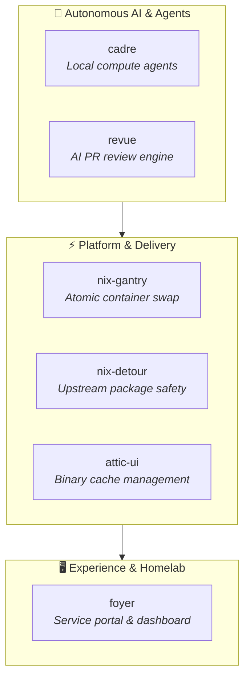

  
  <h1>kleinbem.dev</h1>
  
<strong>Reproducible Systems · Local AI Execution · Developer Tooling</strong>

  

    
    
    
  

---

### 🌟 About

**kleinbem.dev** houses production-grade, open-source software tools and runtime platforms developed by [Martin Kleinberger](https://github.com/kleinbem). Each project here originated from real-world infrastructure, local AI orchestration, or developer workflows, engineered into reusable, standalone open-source products.

---

### 📦 Standalone Products & Projects

| Project | Tech Stack | Highlights |
| :--- | :--- | :--- |
| **[`cadre`](https://github.com/kleinbem-dev/cadre)** | Nix · Python · Ollama · Mesh-LLM | **Private AI teammates on your own compute.** Autonomous developer agents running on local hardware inference via Goose and custom execution runtimes. |
| **[`revue`](https://github.com/kleinbem-dev/revue)** | Rust · Svelte · Tailwind · Ollama | **Nix-native AI PR code review engine.** Automated code reviewer with smart multi-tier model fallback (Ollama, Claude, Gemini) and Forgejo/GitHub support. |
| **[`attic-ui`](https://github.com/kleinbem-dev/attic-ui)** | SvelteKit · TypeScript · Tailwind | **Modern web interface & store inspector for Attic.** Next-generation management portal for self-hosted Nix binary caches. |
| **[`nix-gantry`](https://github.com/kleinbem-dev/nix-gantry)** | NixOS · systemd-nspawn · Bash | **Zero-eval atomic container deployment.** Builds containers once in CI; target hosts fetch manifests and swap them atomically without local evaluation. |
| **[`nix-detour`](https://github.com/kleinbem-dev/nix-detour)** | Nix · Svelte · Nixpkgs | **Surgical Nixpkgs package detention.** Safely hold back broken packages from `nixos-unstable` or inject open PR fixes until upstream merges. |
| **[`foyer`](https://github.com/kleinbem-dev/foyer)** | SvelteKit · Tailwind · NixOS | **Next-gen homelab portal & service launchpad.** Lightweight, reactive application dashboard for multi-node self-hosted platforms. |

---

### 🏗 Architecture & Ecosystem

---

### 📐 Engineering Values

- **Reproducibility First:** Built strictly on declarative infrastructure (Nix Flakes, OpenTofu, hermetic builds).
- **Local-First & Privacy-Conscious:** AI tools engineered for local, hardware-accelerated compute (CUDA, ROCm, Vulkan, Apple Silicon, Jetson).
- **High Performance:** Core systems and runtimes implemented in Rust; interfaces crafted with modern Svelte 5 / SvelteKit for near-instant reactivity.
- **Strict Quality Control:** Every repo runs declarative branch protection, sign-off rules, CodeRabbit automated reviews, and CI test pipelines.

---

### 🔗 Connect & Services

- **Founder & Maintainer:** [@kleinbem](https://github.com/kleinbem) (NixOS / nixpkgs package maintainer)
- **Consulting & Business:** [kleinbem.dev](https://kleinbem.dev)
- **Declarative Fleet Infrastructure:** [github.com/kleinbem](https://github.com/kleinbem)
- **Inquiries:** `martin.kleinberger@gmail.com`
